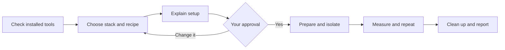

# Compare The SEO Framework with other SEO plugins

Open this repository in Codex, Cursor, VS Code Copilot, or Claude. Copy this prompt:

```text
Help me run a trustworthy SEO plugin benchmark using this repository: https://github.com/theseoframework/wp-plugin-benchmark
Read the repository instructions and docs/agent-workflow.md first.
Check which native WordPress stacks I already have. Offer Local with its
official CLI or a suitable existing stack, and explain the proposed setup.
If using Local, confirm I have manually created and opened my first site.
Hand control back for OS permission prompts before continuing automation.
Offer TSF's reference recipe and let me question or change the experiment.
Ask for my time and spending budget. Offer 10/40/100 iteration targets,
show their rounded request counts and estimated time, and let me choose
all supported frontend HTML routes or a subset and which configurations.
Read docs/run-budget.md and docs/agent-costs.md. Label untested estimates.
Compare TSF with Yoast SEO, Rank Math, SEOPress, Slim SEO, and AIOSEO
both standalone and with the reference recipe's default companion bundle.
Show me the downloads, site changes, network isolation, expected workload,
and cleanup. Wait for my approval before installing or setting anything up.
Then run the approved experiment, check its consistency, and explain the
results and limitations. Keep the evidence even if TSF does not win.
```

## First time using Local?

Before agent-assisted site setup:

1. Open Local yourself and create a disposable WordPress site.
2. Review and complete any OS permission prompts yourself.
3. Open that site's homepage and WordPress admin to confirm Local works.
4. Return to your agent and continue. Tell it explicitly if this site should be the benchmark target.

**Pause computer control while handling permission prompts.** On Windows, UAC or firewall prompts can be inaccessible while an agent controls the desktop. If a prompt appears later, the agent should hand control back and wait, rather than repeatedly retry setup. Review the requested access; this benchmark needs loopback access, not public-network access.

If you already have a working Local site, you do not need another first-site check. An existing site is used for benchmarking only with your explicit approval. Users of another native stack can skip this Local step.

Local's website may ask for an email address before downloading. Direct installers are also published on its official CDN. Your agent can read the public [WinGet manifests](https://github.com/microsoft/winget-pkgs/tree/master/manifests/f/Flywheel/Local) for Windows or [Homebrew cask](https://github.com/Homebrew/homebrew-cask/blob/main/Casks/l/local.rb) for macOS to find a versioned URL and SHA-256. These are community package catalogs, not a Local-maintained release API; you do not need to install either package manager. Download only from Local's official CDN after approval, verify the hash and platform signing identity before execution, and record the exact version and architecture. If metadata is missing or stale, use [Local's releases page](https://localwp.com/releases/).

## What happens next

1. **Check:** your agent finds available tools without changing your sites.
2. **Choose:** you choose the stack and benchmark recipe.
3. **Approve:** your agent explains the setup. You approve it in your agent's interface; your OS may also ask for permission.
4. **Test:** after packages are cached and isolation is confirmed, the runner checks the server, creates the fixtures, and measures all planned passes. On Windows, its optional worker supervisor tests real WordPress across worker recycling before collection, without patching Local.
5. **Review:** cleanup is verified, then you get the report and an evidence export you can share.



**Nothing is installed or set up without your approval.** Existing development sites are not automatic test targets. Local and an existing native stack use the same benchmark method.

The main benchmark compares **The SEO Framework against Yoast SEO, Rank Math, AIOSEO, SEOPress, and Slim SEO**. AIOSEO is measured separately with and without the default companion bundle pinned in the reference recipe: MonsterInsights, OptinMonster, Broken Link Checker, and Universally. Both configurations stay visible in the report.

The reference recipe covers nine frontend HTML routes and three complete passes, with two WordPress-only controls. Small smoke tests check the plumbing; they do not establish a broad performance claim.

## Choose time and cost before setup

Your agent should ask how much time you have, which page types and plugin configurations to test, and whether there is an API spending cap. Estimates below retain all nine configurations and all nine frontend HTML routes on the tested **Ryzen 7 5800X3D / 64 GiB Windows** machine:

| Requested iterations per configuration, route and pass | Actual rounded count | Purpose | Estimated collection time |
| --- | ---: | --- | --- |
| 10 | 18 | Smoke test, one pass | About 15 min, projected |
| 40 | 54 | Limited investigation, two passes | About 1 h 7 min, projected |
| 100 | 108 | Reference-sized repeated collection, three passes | **2 h 24 min observed** |

These use existing recipe fields, not new CLI flags. Balanced request orders explain the rounding. The 40 choice preserves the reference warmup count; both 10 and 40 are classified as smoke-only by the current analysis rules. Allow additional time for qualification (about nine minutes for the tested Windows preflight), downloads, setup, approvals, cleanup, and reporting. Route subsets can be much quicker; configuration subsets need both controls, an anchor, and a comparator. **More iterations do not guarantee accuracy:** the completed reference run's historical version 1.0.0 verdict was inconclusive because its timing gates failed. All currently supported collection is frontend HTML; admin, RSS, and sitemap cohorts are not implemented.

The first Windows implementation/test was run by **GPT-6.1 Sol high**. It used about 75.66M input tokens (99.41% cached) and 224k output tokens, including development and troubleshooting in a long chat. This is not a normal rerun budget. A fresh-chat full Windows rerun has an **unevaluated planning allowance of roughly 3–12M input and 50k–150k output tokens**, plus a troubleshooting reserve. Subscriptions and direct API charges differ. See the [time/scope tables](docs/run-budget.md) and [audited usage, pricing and subscription guide](docs/agent-costs.md) before accepting an estimate. **Grok 4.7 on macOS: not evaluated.**

## Understand the result

The report explains what ran, whether the environment was suitable, and whether repeated passes agreed. It distinguishes whole-response time from **estimated plugin-added time**. CPU load and available thermal readings have sources and coverage; missing sensors stay explicitly unavailable.

The default analysis is version 2.0.0, `paired-block-1`: paired millisecond differences and simultaneous confidence intervals are primary. It keeps every declared route, configuration, pass, and negative cell. Threshold contrasts avoid dividing by a noisy addition; the ratio of average additions is descriptive and differs from the historical mean of route ratios. Reference-sized threshold support requires all five dependence/pass analyses and the per-pass checks, and applies only conditionally to the observed session. One uncertain comparator does not veto other comparisons; a claim about all comparators needs support for every one.

The new method was adopted after reviewing the completed Windows data. Reanalyzing those same observations is retrospective and exploratory, not independent confirmation. The original version 1.0.0 report, inconclusive verdict, and evidence remain intact. `php benchmark.php report --run OLD --out NEW` generates the full current comparison offline in a fresh export; `verify` still replays historical evidence with its recorded version. See the [review and caveats](docs/statistical-review.md).

The reference recipe is an invitation to reproduce and challenge the experiment. Change the workload or settings when useful, and keep those changes visible. No result is predetermined.

- [Agent workflow](docs/agent-workflow.md)
- [Method, comparisons, and repeatability](docs/methodology.md)
- [Requirements and environment limitations](docs/environment.md)
- [Command reference](docs/cli.md)
- [macOS validation checklist](docs/macos-validation.md)
- [What has been tested](docs/validation.md)
- [Workload choices and estimated time](docs/run-budget.md)
- [Agent token usage and cost estimates](docs/agent-costs.md)

## Compare other supported SEO plugins

You can also compare supported SEO plugins with each other, such as Yoast SEO against Slim SEO. Choose a comparison anchor: the plugin against which direct differences and threshold contrasts are calculated. Its estimated addition is also the denominator in the descriptive ratio of average additions. TSF can be omitted from this custom experiment.

Use this alternate prompt and replace the bracketed plugin names:

```text
Help me compare [plugin A] with [plugin B] using this repository: https://github.com/theseoframework/wp-plugin-benchmark
Read the repository instructions and docs/agent-workflow.md first.
Use supported SEO plugins and help me choose the comparison anchor and
configurations. Record these choices in a custom recipe.
Use the same methodology as the TSF reference: two WordPress-only controls,
balanced request orders, warmups, repeated passes, output validation,
environment checks, and reproducible evidence. Ask for my time/spending
budget, routes, configurations and sampling target before planning.
Explain smoke versus repeated collection and show estimated time/cost.
Keep the complete workload I approve; do not silently shrink it later.
Check installed native WordPress stacks and explain the proposed setup,
downloads, site changes, network isolation, expected workload, and cleanup.
Wait for my approval before installing or setting anything up.
Then run the approved experiment and explain its consistency, results,
and limitations. Keep all evidence regardless of which plugin wins.
```

The supported plugins are those listed above. Other plugins need verified setup and output checks before they can be compared. The same measurement and evidence rules apply whichever plugin is the anchor; changing the participants does not make a result universal.

## Bonus: explain the differences

```text
Investigate why the plugins in this benchmark perform differently.
Read docs/code-quality.md and the evidence before making claims.
Compare relevant code paths, algorithms, repeated work, database access,
caching, setup, and enabled features. Explain where TSF is efficient and
where it is not. Do not assume that speed means missing features, or that
more code means worse quality. Separate measured facts from hypotheses,
show source locations, and suggest fair follow-up tests. Make no plugin
changes and install nothing without my approval.
```

## Develop the runner

The runner uses PHP and existing native tools. It does not require Node, Python, Composer packages, or `wp-plugin-performance`.

```sh
php benchmark.php doctor
php tests/run.php
```

The test suite checks the runner without installing WordPress. Windows and macOS integration checks must be recorded separately; a test passing on one OS does not certify the other.

For PHP coding checks, use an already installed PHP_CodeSniffer with the TSF standard:

```sh
phpcs
```

The repository ruleset applies TSF conventions to PHP 8.2+. It documents the few CLI and test-fixture exceptions, including native filesystem operations and vendor API signatures. VS Code's PHPCS extension discovers this ruleset automatically when configuration search is enabled. These development tools are optional for running the benchmark; Local with its CLI supplies the required runtime.

## License

TSF WordPress Benchmark is free software licensed under [GNU GPLv3](license.txt).
Copyright © 2026 Sybre Waaijer, CyberWire B.V.
