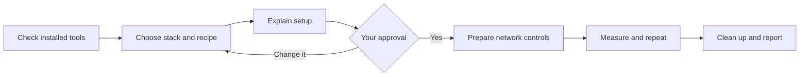

# Compare The SEO Framework with other SEO plugins

Open this repository in Codex, Cursor, VS Code Copilot, or Claude. Copy this prompt:

```text
Help me run a trustworthy SEO plugin benchmark using this repository: https://github.com/theseoframework/tsf-wp-benchmark
Read the repository instructions and docs/agent-workflow.md first.
Check which native WordPress stacks I already have. Offer Local with its
official CLI or a suitable existing stack, and explain the proposed setup.
If using Local, explain site creation and OS prompts; on Windows, complete
the manual first-site check. Hand control back for OS permission prompts.
Offer TSF's reference recipe and let me question or change the experiment.
Recommend a workload and offer 10/40/100 iteration targets with rounded
request counts, estimated phase durations, and token/API-equivalent cost
for the current model. Let me choose or adjust routes and configurations.
Read docs/run-budget.md and docs/agent-costs.md. Label projections and
billing unknowns; respect any limits I give without asking for a budget.
Compare TSF with Yoast SEO, Rank Math, SEOPress, Slim SEO, and AIOSEO
both standalone and with the reference recipe's default companion bundle.
Show me the downloads, site changes, network controls, expected workload,
and cleanup. Wait for my approval before installing or setting anything up.
Then run the approved experiment, check its consistency, and explain the
results and limitations. Keep the evidence even if TSF does not win.
```

## First time using Local?

On macOS, after you approve setup and enable Local's official CLI, your agent can create the first dedicated benchmark site. Open Local's profile icon, then Preferences -> Advanced -> Install Local CLI -> Apply. The agent should inspect the installed CLI's help and supported runtimes before creating it.

On Windows, complete the first-site check before automated site setup:

1. Open Local yourself and create a disposable WordPress site.
2. Review and complete any OS permission prompts yourself.
3. Open that site's homepage and WordPress admin to confirm Local works.
4. Return to your agent and continue. Tell it explicitly if this site should be the benchmark target.

**Every new site may request OS authentication, file access, or runtime installation**, even after another site works. The agent should explain the selected site and expected prompts, pause for you to handle them, then check the existing creation attempt before retrying. Enter OS passwords only in the system prompt, never in chat or command arguments.

**Pause computer control while handling permission prompts.** On Windows, UAC or firewall prompts can be inaccessible while an agent controls the desktop. If a prompt appears later, the agent should hand control back and wait, rather than repeatedly retry setup. Review the requested access; this benchmark needs loopback access, not public-network access.

An already working Local site satisfies the Windows first-site check, but creating another site can still prompt. An existing site is used for benchmarking only with your explicit approval. Users of another native stack can skip this Local step.

Local's website may ask for an email address before downloading. Direct installers are also published on its official CDN. Your agent can read the public [WinGet manifests](https://github.com/microsoft/winget-pkgs/tree/master/manifests/f/Flywheel/Local) for Windows or [Homebrew cask](https://github.com/Homebrew/homebrew-cask/blob/main/Casks/l/local.rb) for macOS to find a versioned URL and SHA-256. These are community package catalogs, not a Local-maintained release API; you do not need to install either package manager. Download only from Local's official CDN after approval, verify the hash and platform signing identity before execution, and record the exact version and architecture. If metadata is missing or stale, use [Local's releases page](https://localwp.com/releases/).

## What happens next

1. **Check:** your agent finds available tools without changing your sites.
2. **Choose:** you choose the stack and benchmark recipe.
3. **Approve:** your agent explains the setup. You approve it in your agent's interface; your OS may also ask for permission.
4. **Test:** after packages are cached and the chosen network controls are reviewed, the runner checks the server, creates the fixtures, and measures all planned passes. On Windows, its optional worker supervisor tests real WordPress across worker recycling before collection, without patching Local.
5. **Review:** cleanup is verified, then you get the report and an evidence export you can share.



**Nothing is installed or set up without your approval.** Existing development sites are not automatic test targets. Local and an existing native stack use the same benchmark method.

Choose the network setup:

- **Native, fewer restrictions (default):** block and privately log WordPress HTTP and mail, disable automatic updates and cron, and permit traffic outside those hooks.
- **Stronger isolation (optional):** use verified external blocking, potentially in a separately prepared container. A container alone does not block outbound traffic. Docker is not required.

Your agent should present these options and use the default unless you choose stronger isolation. It explains remaining network access as part of the setup proposal, without a separate isolation approval prompt for the default. See the [pinned-plugin network audit](docs/network-audit.md) for known optional transports outside WordPress HTTP.

The main benchmark compares **The SEO Framework against Yoast SEO, Rank Math, AIOSEO, SEOPress, and Slim SEO**. AIOSEO is measured separately with and without the default companion bundle pinned in the reference recipe: MonsterInsights, OptinMonster, Broken Link Checker, and Universally. Both configurations stay visible in the report.

The reference recipe covers nine frontend HTML routes and three complete passes, with two WordPress-only controls. Small smoke tests check the plumbing; they do not establish a broad performance claim.

## Estimate duration and cost before setup

Your agent should recommend a workload for your goal, show estimated time by phase and token/API-equivalent cost for its current model, and let you choose or adjust the scope. It should respect limits you provide without asking you to invent a time or spending budget. For a broad comparison, recommend the 100 tier; 10 and 40 remain smoke-only alternatives. The Windows estimates below retain all nine configurations and all nine frontend HTML routes on the tested **Ryzen 7 5800X3D / 64 GiB** machine:

| Requested iterations per configuration, route and pass | Actual rounded count | Purpose | Windows collection | Apple M4 collection |
| --- | ---: | --- | --- | --- |
| 10 | 18 | Smoke test, one pass | About 15 min, projected | Not evaluated |
| 40 | 54 | Limited investigation, two passes | About 1 h 7 min, projected | Not evaluated |
| 100 | 108 | Reference-sized repeated collection, three passes | **2 h 24 min observed** | **29 min 10 s observed** |

Both observed duration baselines used stronger external controls. The new WordPress-hook default has not yet been timed in a live collection; use these as provisional planning baselines, not evidence of an identical experiment.

These use existing recipe fields, not new CLI flags. Balanced request orders explain the rounding. The 40 choice preserves the reference warmup count; both 10 and 40 are classified as smoke-only by the current analysis rules. Smaller Mac sampling tiers and an M1 Mac have not been evaluated; the different hosts and stacks do not establish a universal speed factor. Allow additional time for qualification (about nine minutes for the tested Windows preflight), downloads, setup, approvals, cleanup, and reporting. Route subsets can be much quicker; configuration subsets need both controls, an anchor, and a comparator. **More iterations do not guarantee accuracy:** the completed reference run's historical version 1.0.0 verdict was inconclusive because its timing gates failed. All currently supported collection is frontend HTML; admin, RSS, and sitemap cohorts are not implemented.

The first Windows implementation/test was run by **GPT-6.1 Sol high**. It used about 75.66M input tokens (99.41% cached) and 224k output tokens, including development and troubleshooting in a long chat. This is not a normal rerun budget. A fresh-chat full Windows rerun has an **unevaluated planning allowance of roughly 3–12M input and 50k–150k output tokens**, plus a troubleshooting reserve. Convert the provisional token range using the current model's verified rates and explicit cache/context assumptions; show estimated API-equivalent dollars and, when known, the share of the eligible subscription pool. Label unknown incremental cash charges separately. The preliminary **Grok 4.7 high Mac setup and discussion** recorded 22.65M tokens, marked Included, with a **$12.88 regular-rate API-equivalent scenario**; this was not a completed benchmark. See the [time/scope tables](docs/run-budget.md) and [usage, pricing and allowance details](docs/agent-costs.md).

## Understand the result

The report explains what ran, whether the environment was suitable, and whether repeated passes agreed. It distinguishes whole-response time from **estimated plugin-added time**. CPU load and available thermal readings have sources and coverage; missing sensors stay explicitly unavailable.

The default analysis is version 2.0.0, `paired-block-1`: paired millisecond differences and simultaneous confidence intervals are primary. It keeps every declared route, configuration, pass, and negative cell. Threshold contrasts avoid dividing by a noisy addition; the ratio of average additions is descriptive and differs from the historical mean of route ratios. Reference-sized threshold support requires all five dependence/pass analyses and the per-pass checks, and applies only conditionally to the observed session. One uncertain comparator does not veto other comparisons; a claim about all comparators needs support for every one.

The new method was adopted after reviewing the completed Windows data. Reanalyzing those same observations is retrospective and exploratory, not independent confirmation. The original version 1.0.0 report, inconclusive verdict, and evidence remain intact. `php benchmark.php report --run OLD --out NEW` generates the full current comparison offline in a fresh export; `verify` still replays historical evidence with its recorded version. See the [review and caveats](docs/statistical-review.md).

The reference recipe is an invitation to reproduce and challenge the experiment. Change the workload or settings when useful, and keep those changes visible. No result is predetermined.

- [Agent workflow](docs/agent-workflow.md)
- [Method, comparisons, and repeatability](docs/methodology.md)
- [Requirements and environment limitations](docs/environment.md)
- [Command reference](docs/cli.md)
- [macOS validation checklist](docs/macos-validation.md)
- [What has been tested](docs/validation.md)
- [Workload choices and estimated time](docs/run-budget.md)
- [Agent token usage and cost estimates](docs/agent-costs.md)

## Compare other supported SEO plugins

You can also compare supported SEO plugins with each other, such as Yoast SEO against Slim SEO. Choose a comparison anchor: the plugin against which direct differences and threshold contrasts are calculated. Its estimated addition is also the denominator in the descriptive ratio of average additions. TSF can be omitted from this custom experiment.

Use this alternate prompt and replace the bracketed plugin names:

```text
Help me compare [plugin A] with [plugin B] using this repository: https://github.com/theseoframework/tsf-wp-benchmark
Read the repository instructions and docs/agent-workflow.md first.
Use supported SEO plugins and help me choose the comparison anchor and
configurations. Record these choices in a custom recipe.
Use the same methodology as the TSF reference: two WordPress-only controls,
balanced request orders, warmups, repeated passes, output validation,
environment checks, and reproducible evidence. Recommend routes,
configurations and sampling, and let me choose or adjust before planning.
Explain smoke versus repeated collection and proactively estimate phase
durations, tokens and API-equivalent cost for the current model. Respect
limits I provide without asking for time or spending budgets.
Keep the complete workload I approve; do not silently shrink it later.
Check installed native WordPress stacks and explain the proposed setup,
downloads, site changes, network controls, expected workload, and cleanup.
Wait for my approval before installing or setting anything up.
Then run the approved experiment and explain its consistency, results,
and limitations. Keep all evidence regardless of which plugin wins.
```

The supported plugins are those listed above. Other plugins need verified setup and output checks before they can be compared. The same measurement and evidence rules apply whichever plugin is the anchor; changing the participants does not make a result universal.

## Bonus: explain the differences

```text
Investigate why the plugins in this benchmark perform differently.
Read docs/code-quality.md and the evidence before making claims.
Compare relevant code paths, algorithms, repeated work, database access,
caching, setup, and enabled features. Explain where TSF is efficient and
where it is not. Do not assume that speed means missing features, or that
more code means worse quality. Separate measured facts from hypotheses,
show source locations, and suggest fair follow-up tests. Make no plugin
changes and install nothing without my approval.
```

## Develop the runner

The runner uses PHP and existing native tools. It does not require Node, Python, Composer packages, or `wp-plugin-performance`.

```sh
php benchmark.php doctor
php tests/run.php
```

The test suite checks the runner without installing WordPress. Windows and macOS integration checks must be recorded separately; a test passing on one OS does not certify the other.

For PHP coding checks, use an already installed PHP_CodeSniffer with the TSF standard:

```sh
phpcs
```

The repository ruleset applies TSF conventions to PHP 8.2+. It documents the few CLI and test-fixture exceptions, including native filesystem operations and vendor API signatures. VS Code's PHPCS extension discovers this ruleset automatically when configuration search is enabled. These development tools are optional for running the benchmark; Local with its CLI supplies the required runtime.

## License

TSF WordPress Benchmark is free software licensed under [GNU GPLv3](license.txt).
Copyright © 2026 Sybre Waaijer, CyberWire B.V.
